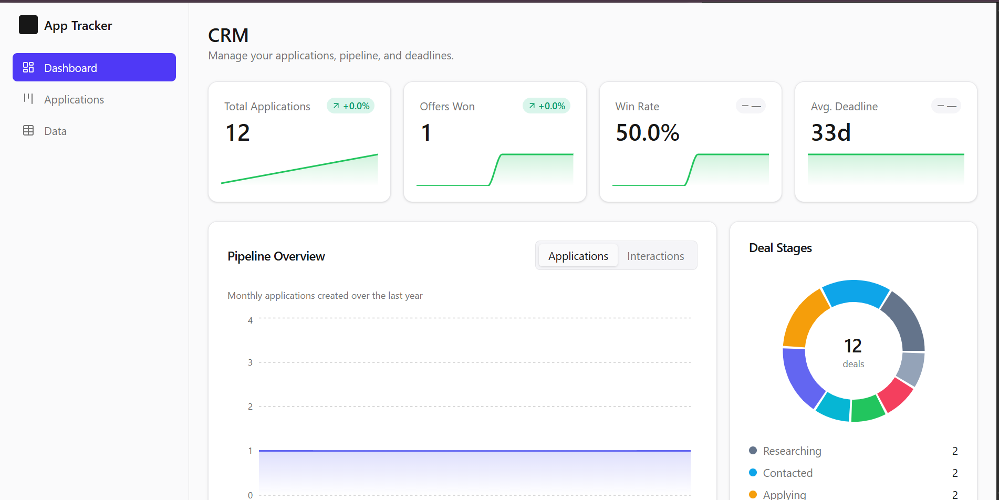

# Application Tracker CRM

A full-stack web app to manage an internship and scholarship search: **organizations**, **contacts**, **applications** (with pipeline stages and deadlines), an **interaction log**, and **tasks**.

Built as a learning project covering the full stack: a typed REST API, a relational database with migrations, authentication and ownership, automated tests, Docker, and CI.

## Preview



## Features

- Register / log in; each user sees **only their own data** (enforced on every query).
- CRUD for organizations and contacts.
- Applications with a pipeline (`researching → contacted → applying → submitted → interview → offer`) plus `rejected` / `withdrawn` from any stage. Invalid stage moves are rejected with a clear error.
- Interaction log (email, portal, whatsapp, call, meeting, other).
- Tasks with due dates, plus "due soon" and "overdue" views.
- Applications board with switchable **Kanban / List / Table** views, and a **Data** page with tables for every entity.
- Dashboard with KPI cards, a 12-month pipeline trend chart, a deal-stage donut, top organizations, and lead-source breakdowns.
- Timezone-aware deadlines that remember the original time zone.
- Dark/light theme with an adaptive square logo.
- One command to run everything: `docker compose up`.

## Architecture

```
Browser  (React + TypeScript, Tailwind CSS + shadcn/ui)
   |  JSON over HTTP
   v
API  (FastAPI, Python)  ---->  PostgreSQL
        |
        +-- Alembic migrations, SQLAlchemy 2.x, Pydantic v2

Everything runs together in Docker Compose.
GitHub Actions runs tests and builds on every push.
```

## Tech stack

| Layer | Choice |
|---|---|
| API | FastAPI (Python 3) |
| Data access | SQLAlchemy 2.x + Pydantic v2 |
| Database | SQLite for local dev, PostgreSQL in Docker |
| Migrations | Alembic |
| Auth | bcrypt password hashing + JWT (PyJWT) |
| Tests | pytest + FastAPI TestClient |
| Frontend | React + TypeScript (Vite), Tailwind CSS v4, shadcn/ui-style components |
| Containers | Docker + Docker Compose |
| CI | GitHub Actions |

## Quick start (Docker)

```bash
docker compose up --build
```

- API + docs: http://localhost:8000/docs
- Web app: http://localhost:5173

Seed a demo account (fake data only):

```bash
docker compose exec api python -m app.seed
```

Log in with `demo@example.com` / `password123`.

## Local development (no Docker)

Backend (uses SQLite by default):

```bash
cd api
python3 -m venv .venv
.venv/bin/pip install -r requirements-dev.txt
.venv/bin/alembic upgrade head
.venv/bin/uvicorn app.main:app --reload
```

Frontend:

```bash
cd web
npm install
npm run dev
```

## Running tests and lint

```bash
cd api
.venv/bin/pytest -q        # run the test suite
.venv/bin/ruff check .     # lint
```

Or use the Makefile: `make api-test`, `make api-lint`, `make up`, `make down`, `make seed`, `make reset-db`.

## API surface

| Area | Endpoints |
|---|---|
| Auth | `POST /auth/register`, `POST /auth/login`, `GET /auth/me` |
| Organizations | `GET, POST /organizations`; `GET, PATCH, DELETE /organizations/{id}` |
| Contacts | `GET, POST /contacts`; `GET, PATCH, DELETE /contacts/{id}` |
| Applications | `GET, POST /applications`; `GET, PATCH, DELETE /applications/{id}`; `GET /applications/upcoming` |
| Interactions | `GET, POST /interactions`; `GET, PATCH, DELETE /interactions/{id}` |
| Tasks | `GET, POST /tasks`; `PATCH, DELETE /tasks/{id}`; `GET /tasks/due` |
| Health | `GET /health` |

## Design decisions

- **Ownership via `user_id`.** Every table carries `user_id`, and every query filters by the current user. This makes cross-user data leaks structurally impossible (the IDOR class of bug) rather than a hope.
- **`stage` is an enum** with a service-layer transition table, not free text, so invalid pipeline moves are rejected.
- **Migrations from day one.** Tables are created via Alembic, not `create_all`, so the schema is versioned.
- **SQLite → PostgreSQL.** Local dev needs no database server; Docker swaps in Postgres via a single `DATABASE_URL` change.
- **Token in `localStorage`.** Simplest for a learning project; it trades away CSRF protection for XSS. Cookies are the more hardened alternative. Noted as an accepted risk, not an oversight.

## Security

- Passwords are salted and hashed with bcrypt; never logged or stored in plain text.
- Secrets live in environment variables; only `.env.example` is committed.
- CORS is configured for the dev origin only, not `*`.
- The repository contains **fake seed data only**.

## Project structure

```
api/
  app/
    main.py            FastAPI app + CORS + router wiring
    config.py          settings from environment (.env)
    db.py              engine, session, Base
    deps.py            get_current_user dependency
    security.py        bcrypt + JWT
    models/            SQLAlchemy models
    schemas/           Pydantic schemas
    routers/           one router per resource
    services/          business rules (stage transitions)
    seed.py            fake demo data
  tests/               pytest suite
  alembic/             migrations
  Dockerfile
web/
  src/
    components/        ui primitives + Logo
    pages/             Login, Dashboard, Applications, detail
    lib/               typed API client, auth context, utils
  Dockerfile
docker-compose.yml
.github/workflows/ci.yml
Makefile
docs/
  dashboard.png        README preview screenshot
```

## Next steps (stretch)

- Document checklist per application (CV, transcript, cover letter).
- Daily email digest of upcoming deadlines (background worker + SMTP).
- Cloud deployment (AWS free tier, with budget alerts).

## License

MIT
